# VisaRef: build deep dive

## 0. The card in one breath
- **Whose job:** Gloria, the visa application officer at a Lebanese travel agency.
- **Trigger:** an applicant sends a passport plus supporting documents (WhatsApp or email; for the demo, uploaded in the web inbox).
- **Done:** every requirement in the destination checklist has a PASS, FAIL or NEEDS_HUMAN result with evidence. A request for missing or fixed documents is drafted, suspicious items are flagged, and the file is waiting for **Gloria to Approve it or Send it back**. Nothing leaves the building without her click.

## 1. Architecture

```mermaid
flowchart LR
  subgraph Intake
    A1["Web upload (demo)"] --> Q
    A2["WhatsApp Cloud API (optional)"] --> Q
    A3["Email inbox (optional)"] --> Q
  end
  Q["Application + files on disk"] --> N["Normalize: PDF to PNG pages<br/>PyMuPDF / Pillow"]
  N --> C["Classify pages<br/>LLM vision to doc_type"]
  C --> X["Extract per doc<br/>LLM vision to Pydantic JSON<br/>+ confidence + page"]
  N --> M["MRZ engine<br/>passporteye OCR + ICAO check digits"]
  X --> M
  M --> F[("Facts store (SQLite)")]
  X --> F
  F --> R["Rules engine - PURE PYTHON<br/>checklist YAML per destination"]
  K["checklists/*.yaml"] --> R
  R --> O["Outcome<br/>READY / NEEDS_GLORIA / SEND_BACK"]
  R --> D["Draft applicant message<br/>code supplies facts, LLM phrases"]
  O --> UI["Review screen<br/>evidence per check"]
  D --> UI
  UI -->|"Gloria clicks Send / Approve"| L{{"Lock service<br/>session + one-time token"}}
  L --> S["Outbound adapter<br/>WhatsApp / email / copy"]
  L --> P["Retention job<br/>auto-delete files"]
  X -.->|tokens| COST["Cost log"]
  D -.->|tokens| COST
```



### Data flow for one application
1. `POST /applications` stores the files in `data/applications/<id>/raw/`, along with the `checklist_id` and `submission_date`.
2. **Normalize:** each PDF page is rendered to a PNG at 200 dpi with PyMuPDF, and photos are fixed for EXIF rotation and downscaled to ≤2000 px.
3. **Classify:** one cheap LLM call per page returns `ClassifiedPage{doc_type, confidence}`, and pages are grouped into documents.
4. **Extract:** one LLM call per document, with a JSON schema from `schemas/models.py`. Every field carries `{page, confidence, raw_text}`.
5. **MRZ:** passporteye reads the MRZ from the passport image. If it fails, the engine falls back to the MRZ lines the LLM transcribed. **Either way, the ICAO check digits are verified in code.** The MRZ fields then override the LLM's reading of the printed fields, and any disagreement goes to the `PP.MRZ_MATCHES_VIZ` check.
6. **Rules:** the engine loads the checklist YAML and runs each rule's `check` function from the registry with its `params`. Each rule returns a `CheckResult` with evidence. Rules whose documents are missing go to `skipped_rules`.
7. **Outcome:** computed in code (see the checklist's `outcome:` section). `escalations` counts the non-manual NEEDS_HUMAN results plus any FAIL with `on_fail: flag`.
8. **Draft:** for `on_fail: request` failures, code builds a fact list (rule, what's wrong, what's needed, dates as DD/MM/YYYY), and the LLM only phrases it. The result is saved as `ApplicantMessageDraft(status=DRAFT)`.
9. **Review UI:** Gloria sees each check with a thumbnail crop of the evidence page. She can edit the draft, then click **Send request** or **Approve file**.
10. **Lock:** `POST /drafts/{id}/send` and `POST /applications/{id}/approve` require Gloria's session and a one-time `confirm_token` issued when she opens the confirm modal. Only `lock/actions.py` imports the outbound adapters.
11. **Retention:** the files are purged `RETENTION_DAYS_AFTER_DECISION` days after the decision, or after `RETENTION_DAYS_IDLE` if the file is abandoned. Only the audit log (rule IDs, statuses, hashes, no images) is kept.

## 2. The principle: AI extracts, code decides
| Layer | Allowed to | Never allowed to |
|---|---|---|
| LLM (Gemini / Claude) | read pixels → typed fields; give confidence; list anomalies; phrase a message from given facts | say "valid", PASS, FAIL; compute dates or sums; choose which docs are required; send anything |
| MRZ engine | parse + checksum the passport | be skipped when the passport is present |
| Rules engine (Python) | every PASS/FAIL, every date and money comparison, name matching, the outcome | call an LLM |
| Gloria | Approve, Send, override any check (logged with a reason) | — |

Why it matters on stage: the judges' unseen cases get **deterministic, explainable** results, and each one cites a rule ID and a source URL.

### Why MRZ is the key trick (the main technical risk the judges named)
- The two MRZ lines carry the passport number, DOB, expiry, nationality, sex and name, protected by **ICAO 9303 check digits** (weights 7-3-1, mod 10) plus a composite digit.
- If OCR or the LLM misreads one digit, the checksum fails, and we retry with a higher-resolution crop or the other reader, then escalate. Silent wrong dates become impossible.
- The MRZ is the **reference identity** for name matching across all the other documents.
- `tools/generate_fake_docs.py` already produces valid MRZs and verifies them with an independent library (`mrz`). Break one digit to build a tamper case.

### Name matching (Mohamad vs Mohammad)
Normalize first: uppercase, strip accents and punctuation, turn `/` into a space, drop titles (MR/MRS/MS), and treat `AL`/`EL`/`AL-` as one particle. Sort the tokens, and use the MRZ name as the reference.
- Exact match after normalizing → PASS (this covers "NASSAR/KARIM MR" vs "KARIM NASSAR").
- `rapidfuzz.fuzz.token_sort_ratio` 85–99 → **NEEDS_HUMAN** with both spellings as evidence (Mohamad/Mohammad = 96.8).
- 70–84 → NEEDS_HUMAN. Below 70 → FAIL (wrong person or wrong document).
- Don't use `token_set_ratio`: "KARIM" vs "KARIM NASSAR" scores 100 with it.
- Later, use a known-variant table (e.g. `MOHAMAD|MOHAMMAD|MOHAMMED|MUHAMMAD`, `EL|AL`) as an *explanation* shown to Gloria. It still goes to NEEDS_HUMAN, because the consulate wants the documents to match the passport.

## 3. Modules
| Module | Responsibility | Key libs |
|---|---|---|
| `ingest/` | upload, page rendering, hashing, dedupe | PyMuPDF, Pillow |
| `extract/llm.py` | provider adapter (Gemini/Claude), JSON-schema output, retries, **token + cost logging** | google-genai, anthropic |
| `extract/classify.py` | page → doc_type | LLM |
| `extract/extract.py` | doc → typed extraction | LLM + Pydantic validation (re-ask once on validation error) |
| `extract/mrz.py` | passporteye OCR, TD3 parse, check digits, VIZ compare | passporteye (needs tesseract), mrz |
| `rules/engine.py` | load YAML, run registry, skip logic, outcome, escalations | PyYAML, Pydantic |
| `rules/checks/*.py` | one pure function per `check:` name (`(facts, params, ctx) -> CheckResult`) | dateutil, rapidfuzz |
| `drafts/drafter.py` | facts → draft text (ar-LB / fr / en) | LLM |
| `lock/actions.py` | `send_draft()`, `approve_application()`, `override_check()`, the only callers of `outbound/` | — |
| `outbound/` | WhatsApp / email / "copy to clipboard" adapters | httpx |
| `storage/` | SQLite models, file store, retention purge (APScheduler or a cron on startup) | SQLModel, cryptography (optional) |
| `eval/run.py` | run all cases → `runs/<label>/<case>.json` | — |
| `frontend/` | Inbox, Application review, Draft editor, Metrics | Next.js, shadcn/ui |

### API surface (FastAPI)
```
POST   /applications                 multipart files + checklist_id → {id}
POST   /applications/{id}/run        → AuditReport
GET    /applications/{id}            → AuditReport + files
GET    /applications/{id}/pages/{n}  → PNG (for evidence thumbnails)
PATCH  /drafts/{id}                  edit body (stays DRAFT)
POST   /auth/officer                 PIN → session cookie
POST   /confirm-tokens               (session) → one-time token, 120 s TTL
POST   /drafts/{id}/send             (session + token) → SENT        ← LOCK
POST   /applications/{id}/approve    (session + token) → APPROVED    ← LOCK
POST   /checks/{id}/override         (session + reason) → logged
DELETE /applications/{id}            (session) → purge now
GET    /metrics                      pass rate history, cost/application, escalations
```

### How the lock is enforced (show this file on stage)
- The pipeline (`extract/`, `rules/`, `drafts/`) **cannot import** `outbound/`. A pytest test walks the AST of those packages and fails if it finds the import (or use `import-linter`).
- `DraftStatus` changes only through `lock/actions.py`. A DB check means `SENT` requires `approved_by` and `approved_at`.
- Each confirm token works once, for one application, with one action, and expires after 120 s. A replayed request gets a 409.
- Every action is written to an `audit_log` row: who, what, when, and a hash of the draft body that was sent.

## 4. Folder structure (target repo)
```
visaref/
├─ .cursor/rules/visaref.mdc
├─ .env.example
├─ checklists/fr-schengen-short-stay.yaml      # + uk-standard-visitor.yaml later
├─ schemas/models.py                           # copy into backend/app/models/ or import
├─ backend/
│  ├─ pyproject.toml
│  ├─ app/
│  │  ├─ main.py  config.py  deps.py
│  │  ├─ ingest/        render.py store.py
│  │  ├─ extract/       llm.py classify.py extract.py mrz.py prompts/
│  │  ├─ rules/         engine.py registry.py names.py dates.py checks/
│  │  ├─ drafts/        drafter.py
│  │  ├─ lock/          actions.py tokens.py
│  │  ├─ outbound/      whatsapp.py email.py
│  │  ├─ storage/       db.py files.py retention.py audit.py
│  │  └─ eval/          run.py
│  └─ tests/            test_mrz.py test_names.py test_rules_*.py test_lock.py test_cases.py
├─ frontend/            Next.js app (app/inbox, app/applications/[id], components/ui)
├─ eval/                cases/ score.py history.csv README.md
├─ tools/               generate_fake_docs.py
└─ data/                (gitignored) applicant files + sqlite
```

## 5. Build order (time-boxed from Saturday 11:00, Asia/Beirut)
Risk first: MRZ and extraction before any UI.

| When | Goal | Exit criterion |
|---|---|---|
| **Sat 11:00–12:00** | Repo, venv, `.env`, generate fake docs, schemas in place, checklist loader | `generate_fake_docs.py` prints 5× "valid"; `pytest` runs |
| **Sat 12:00–13:30** | `extract/mrz.py` + `rules/names.py` + `rules/dates.py` with unit tests | MRZ parses and checksums on all 5 passports (plus the `_phone.jpg` version); the Mohamad/Mohammad test passes |
| **Sat 13:30–16:00** | `extract/llm.py` (Gemini first), classify + extract for passport, flight, hotel, insurance, bank | Field-level accuracy ≥ 95% on the 5 cases (compare to `case.yaml`); cost is logged |
| **Sat 16:00–18:30** | Rules engine + all `check:` functions + outcome | `eval/run.py` then `eval/score.py` → **first pass rate** |
| **Sat 18:30–20:30** | Drafter + lock endpoints + minimal review UI (Streamlit is acceptable if Next.js is slow) | Gloria can Send/Approve; the lock test is green |
| **Sat 20:30–22:30** | Scale to 20 cases (see `eval/README.md`), fix the top failures | **Post Saturday-night pass rate + human count + $/application** |
| **Sun 08:00–10:00** | Fix failures, degraded-photo robustness, Next.js polish, metrics page | 20-case pass rate ≥ 18/20 |
| **Sun 10:00–11:00** | Unseen-case drill: a teammate writes 2 new `case.yaml` files blind and you run them cold | Both are processed in under 2 min with no code edits |
| **Sun 11:00–12:00** | Gloria's 30 s voice note, cost slide, rehearse demo ×3, freeze | Demo under 3 min |

If you fall behind, cut in this order: WhatsApp intake → Next.js (use Streamlit) → Claude drafter (use the same Gemini model) → classification (upload with a doc-type dropdown). **Never cut** MRZ, the rules engine, the lock, or the eval.

## 6. Demo script (3 minutes)
1. **(20 s) Hook:** play Gloria's voice note: "Every file takes me 30 to 60 minutes; one wrong date and the applicant loses their appointment."
2. **(40 s) Clean file:** drop case01 in, watch the checks stream in, all green, READY_FOR_APPROVAL. Hover a check to show the evidence crop and the source URL.
3. **(40 s) Broken file:** case05: the hotel ends 20/12 but the flight returns 23/12, so it's a FAIL and a Lebanese-friendly draft is ready. Click **Send**, the confirm modal appears, and Gloria clicks. Point out: "The AI cannot send. This endpoint needs her session and a one-time token."
4. **(30 s) The hard one:** case04: Mohamad vs Mohammad → NEEDS GLORIA with both spellings side by side. Then the tamper case: we changed one digit in the MRZ, the checksum fails, and it's flagged.
5. **(30 s) Numbers:** the metrics page shows the pass rate curve (Fri → Sat → Sun), cases needing Gloria, ≈ $0.13 per file vs ≈ $3.75 of officer time (state your assumptions).
6. **(20 s) Judges' envelope:** "Give us your case." Run it live.

## 7. Pitch points per twist
| Twist | What you show |
|---|---|
| 20 real-ish cases, pass rate Fri/Sat/Sun | `eval/history.csv` → line chart on the metrics page; the case list covers each rule family |
| 2 unseen cases live on Sunday | No code changes: the checklist plus generic checks; any unknown doc type or destination → NEEDS_GLORIA instead of a guess |
| Count humans + plan to reduce | `escalations` per case. Plan: known-variant name table, better scans (phone capture guide), learned per-bank templates, Gloria's overrides feeding the threshold tuning |
| Human-click lock in code | `lock/actions.py`, the confirm-token flow, the AST import test, `audit_log` |
| 30 s voice note from the real officer | Record it with Gloria on Saturday afternoon and play it in the hook |
| Cost per run vs human | `CostLine` per step; ≈ $0.13/application (STACK.md §4) vs 30–60 min of an officer |
| Job exists in Lebanon | TLScontact Beirut handles French visas; the EU sets a Lebanon-specific supporting-document list (C(2024) 1527); travel agencies prepare these files every day |

## 8. Risks and mitigations
| Risk | Mitigation |
|---|---|
| Misread passport digits/dates | MRZ check digits; two readers (passporteye + LLM transcription); retry at higher DPI; escalate on mismatch |
| LLM hallucinates a field that isn't there | The schema allows `null`; the prompt says "null if not visible"; `confidence < 0.8` → `SUS.LOW_CONFIDENCE` → NEEDS_HUMAN |
| Rules wrong or outdated | Every rule has a `source` URL and a `last_verified` date; params live in YAML; Gloria checks the France-Visas personalised list |
| Bank window: EU list says 6 months, TLS Italy list says 3 | Param `BANK.WINDOW.months`; confirm with Gloria and France-Visas |
| Arabic-only docs | Gemini/Claude read Arabic; the schema keeps `*_ar` fields; translation requirements → manual/flag |
| Phone photos, glare, rotation | EXIF transpose, deskew; `--degrade` test variants; a capture tip in the request message |
| Privacy / PII | Fake data only for the hackathon; local storage; optional Fernet encryption; auto-purge; paid API tier for real data (the Gemini free tier says data is "used to improve our products"); redact passport numbers in logs |
| Live demo network or API failure | Cache the extraction JSON per file hash; `DEMO_OFFLINE=1` replays the cache; pre-record a backup video |
| Rate limits | Gemini free tier has low RPM, so add a paid key or queue calls; there's batch mode for the eval |
| Judges ask "is this legal advice?" | No: it's a pre-check that speeds up Gloria, and the consulate decides |
