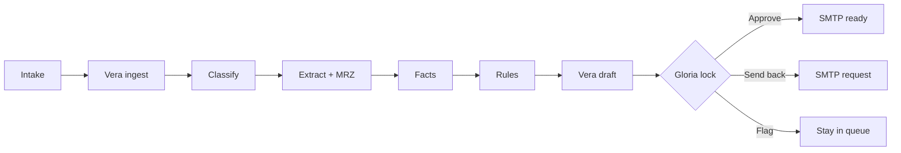

# Vera  
**AlphaHack 2026 · goatpackers**  
*Vera works the file. Gloria makes the call.*

---

## 1. The problem

### 1.1 What a “visa file” actually is

In Lebanon, a France Schengen short-stay application is not one form. It is a **stack of interdependent documents** that must agree with each other and with EU / France-Visas / TLScontact Beirut practice:

- Passport bio page (MRZ + visual zone)  
- France-Visas application printout (signed)  
- Round-trip flight reservation  
- Hotel (or equivalent accommodation) covering the stay  
- Schengen travel medical insurance (≥ **EUR 30,000**, territory, dates)  
- Personal bank statement (typically **six months**, stamped, recent)  
- Employment letter + payslip + CNSS (for employees)  
- Family register extract (*ekhraj kaid aily*), recent enough  
- ID photos + tourism travel plan  

If **one** piece is wrong — insurance in USD, bank too old, hotel ending a day early, passenger name ≠ passport, trip filed too late — the file is not “almost fine.” It is a **failed appointment**, a stressed client, and an agency that looks incompetent.

### 1.2 What happens inside the agency today

Gloria runs the visa desk. She is the manager — the person clients trust, the person who will eventually walk a folder into TLScontact. Around her, employees open PDFs and photos all day.

Without an agent, every file looks like this:

1. Open passport. Squint at MRZ. Hope the scan is readable.  
2. Open the form. Compare surname spelling character by character.  
3. Open flight. Check BEY→CDG dates against hotel and insurance.  
4. Open bank. Count months. Check issue date. Guess if the stamp “counts.”  
5. Open insurance. Is EUR 30k printed, or is it USD dressed up as “enough”?  
6. Write a WhatsApp / email to the client listing what is missing — from memory.  
7. Repeat when the client sends version 2, 3, 4.

**Configured reality in our product baseline:** about **45 minutes of human time per messy file**. That is not “AI hype.” That is how long careful cross-checking takes when a person is the OCR engine, the rules engine, and the email drafter at once.

At ten files a day, that is **seven hours** of document archaeology — before Gloria has done the judgment work that only a manager should do.

### 1.3 Who pays for the mistakes

| Failure | Who hurts |
|---|---|
| Incomplete pack discovered at TLS | Client loses slot; agency looks unprepared |
| Name mismatch across insurance / flight | Refusal risk; emergency rebooking |
| Stale bank or family register | Same — caught late = expensive |
| Junior staff miss a rule Gloria knows by heart | Manager rework; team demoralization |
| “ChatGPT said you’re fine” then TLS says no | Liability + destroyed trust |

The industry does **not** need a model that predicts embassy mood. It needs a system that **never lies about what is on the page**, **never invents FX**, and **never sends the client a message without a human**.

### 1.4 The human cost for employees

Repetitive PDF checking burns people out. Smart juniors become tired copy-paste machines. Gloria, as manager, cannot coach or sell or handle exceptions because she is stuck in the same stack as everyone else.

**The problem, in one line:**  
visa desks drown in consistent, checkable work that humans should not be doing by hand — while the work that *requires* a human (judgment, client trust, TLS) gets starved.

---

## 2. The answer: Vera + Gloria

### 2.1 Roles

| Role | Who | Responsibility |
|---|---|---|
| **Vera** | AI agent — **the product** | Ingest, read, extract, run rules, draft, queue |
| **Gloria** | Human manager — desk lead / mom of the operation | **Mandatory human intervention**: look-items, Approve / Send back, TLS |

Vera prepares. Gloria decides. That split is the entire product philosophy.

### 2.2 What Vera does

1. Pulls visa mail (or upload / seed packs)  
2. Classifies attachments; OCRs scans; extracts fields with **local** Ollama `llama3.2`  
3. Reads passport **MRZ with ICAO 9303 check digits** (checksums — not vibes)  
4. Runs pure Python checks from the France/TLS **YAML checklist**  
5. Builds an audit: PASS / FAIL / NEEDS_HUMAN with evidence  
6. Drafts ready or send-back email text  
7. Stops. She does **not** send. She does **not** approve. She does **not** upload to TLS.

### 2.3 What Gloria does (human intervention)

- Opens Vera’s queue — not a blank Downloads folder  
- Reviews **must-fix** failures and **look with your eye** items (✓ / ✕)  
- Confirms low-confidence extractions (e.g. passport issue date) and photo quality  
- Clicks **Approve & email** or **Send email** under a **one-time confirm token** (120s, replay → 409)  
- Every action lands in an **audit log** (officer, action, timestamp, body sha256)  
- Takes the approved physical/digital pack to TLScontact herself  

If Gloria does not click, nothing leaves the agency. That is intentional.

### 2.4 Time saved — how Vera helps employees

| Before | After |
|---|---|
| ~45 min / file of manual cross-check | Vera digests in minutes; Gloria spends ~**2–5 min** on look-items + decision |
| Juniors exhausted on repetitive reads | Staff work Vera’s queue: clear fails vs look-items |
| Gloria buried in every page | Gloria intervenes where Vera escalates |
| Send-backs written from scratch | Vera drafts; Gloria edits and sends |
| Errors found at TLS | Errors found **before** the appointment |

**Order of magnitude:** for files Vera can fully score, human minutes drop on the order of **~80–90%**. Hard edge cases still escalate — that is a feature. Employees keep their judgment for what matters; Vera eats the grind.

**What the team feels**

- Less PDF archaeology  
- Fewer angry clients from avoidable mistakes  
- Clearer training (“this rule failed because…”)  
- Gloria remains the authority — Vera is the tireless junior who never hits Send alone  

---

## 3. Product thesis (non-negotiables)

1. **AI extracts. Code decides. Gloria locks.**  
   The LLM never outputs PASS/FAIL. Low confidence → NEEDS_HUMAN.  
2. **MRZ-first identity.**  
   Failed checksum → flag Gloria; never silently trust LLM-read names.  
3. **No unsupervised outbound.**  
   No WhatsApp bot. No auto-TLS. Email only after Gloria’s confirm token.  
4. **No LBP fantasy FX.**  
   Unknown currency or destination → NEEDS_HUMAN. Reference currency is checklist EUR.  
5. **Destination logic lives in YAML.**  
   France today; Spain/Italy tomorrow without rewriting the agent brain.

---

## 4. End-to-end pipeline

```text
Email / upload / seed
  → Vera: ingest (PDF text / OCR / classify)
  → Vera: extract (LLM → Pydantic schemas) + MRZ
  → Code: facts → rules engine (checklist)
  → Vera: AuditReport + draft → queue
  → Gloria: look ✓/✕ → Approve & email | Send email
       (confirm token + audit_log)
```



**Orchestration, not a free agent:** IMAP may ingest; background jobs **cannot** call lock actions. The execution graph in the desk shows Gloria (and judges) exactly what Vera ran.

---

## 5. Where AI is used — and where it is forbidden

### 5.1 Vera’s AI (eyes)

| Step | Behavior |
|---|---|
| Classification | Strong keywords first; Llama when ambiguous |
| Extraction | Typed JSON for form, flight, hotel, insurance, bank, employment, payslip, family… |
| LLM flags | Stamp / anomaly style flags → **NEEDS_HUMAN only**, never FAIL |
| Email triage | Route “VISA” mail into the pipeline |

Every call goes through a single gateway: schema validation, retries, cost line, **sha256 cache** (offline demo via `DEMO_OFFLINE=1`).

### 5.2 Code (brain)

Stay ≤ 90 days, filing window, hotel covers stay, insurance ≥ EUR 30k + territory + cover items, bank six-month window and age, funds sufficiency, large deposit flag, employment leave covers trip, payslip recency, family register age, cross-doc name match (`rapidfuzz` `token_sort_ratio` with YAML thresholds — never `token_set_ratio`).

### 5.3 Gloria (hands)

Approve, send back, flag, SMTP, TLS. Manual rules (e.g. PHOTO.ISO) always wait for her eyes.

---

## 6. Rules & scripting (the moat)

Checklist: `checklists/fr-schengen-short-stay.yaml`  
Cited sources: France-Visas, EU Commission supporting-docs list for Lebanon, Service-Public, TLS Beirut practice.

| Mode | Allowed outcomes |
|---|---|
| `code` | PASS / FAIL / NEEDS_HUMAN |
| `llm_flag` | PASS or NEEDS_HUMAN only |
| `manual` | Always NEEDS_HUMAN (not counted as “escalation panic”) |

Each check is a small pure function:

`def check(facts, params, ctx) -> CheckResult`

No network. No LLM. No `datetime.now()` — only `ctx.submission_date`.  
Missing required docs → `skipped_rules`, not invented FAILs.  
Evidence objects point at doc / field / value / page so Gloria can open the right page.

**Eval:** ~30 synthetic cases; unit tests on every check; `test_cases.py` runs rules on `case.yaml` facts (no LLM) against `expected.yaml` so rules bugs never hide behind extraction noise.

---

## 7. Edge cases we built on purpose

Anyone can demo a happy path. Vera is judged on the ugly ones:

| Case | What it proves |
|---|---|
| **EDGE 01 · Joe passport (MRZ)** | Tampered / unreadable MRZ → Gloria; supporting docs can stay Jeff’s |
| **EDGE 02 · Jeff passport + Joe insurance** | Wrong insured name → identity FAIL |
| **EDGE 03 · Jeff passport + Joe flight** | Wrong passenger → identity FAIL |
| **Jason · passport only** | Real thin email → presence FAIL / send back |
| **Jeff · stale dates** | Bank / payslip / family / filing window math vs submission date |
| **Jeff · Dec live email** | Coherent pack → look-items only → Gloria Approve & email |

Hardening from live pain: MRZ name cleanup without destroying real surnames, list **all** mismatched docs on send-back, photo presence without trusting filenames alone, ready draft for look-only files so Approve is not deadlocked.

---

## 8. What Gloria sees (Vera’s desk)

- PIN gate → **Vera** desk branding  
- Queue Vera prepared: needs Gloria / approved / sent back  
- Split UI: **must fix** vs **look with your eye**  
- In-panel document preview  
- Applicant email + Vera’s draft → Gloria’s Send / Approve  
- Execution graph of the run  
- Optional redact after decision (keep outcome audit, strip sensitive docs)

---

## 9. Cost, privacy, business

| Topic | Stance |
|---|---|
| **Inference** | Local Ollama — no cloud LLM invoice for the core loop |
| **Channels** | No WhatsApp / Twilio / Meta (by design) |
| **TLS** | No auto-upload — Gloria walks the file in |
| **Privacy** | Agency-held files; mask passport-like PII in logs; optional encryption / retention |
| **Sell** | Vera seats + destination checklist packs (France first) |
| **Margin** | COGS ≈ electricity + Gloria’s time on exceptions |

Vera multiplies Gloria’s team **without** multiplying headcount or API burn.

---

## 10. Live judge narrative

1. **Problem first** — show edges + incomplete Jason: this is today’s pain.  
2. **Vera at work** — live email of a coherent Jeff pack; watch extract + rules.  
3. **Gloria intervenes** — two look-items, ✓, Approve & email.  
4. **Closing line:**  
   *“Vera worked the file. Code applied the law. Gloria intervened — and only she can send.”*

---

## 11. Closing

Visa desks do not fail because people are lazy. They fail because **the work is too detailed for tired humans and too consequential for unsupervised AI**.

**Vera** absorbs the detail.  
**Gloria** keeps the authority.  
**Human intervention on every outbound action.**  
**Tens of minutes back per file — so employees do skilled work, not PDF archaeology.**

That is the product.

---

*Product name: **Vera**. Gloria is the human manager. Repo path may still say `visaref-spec` historically.*
